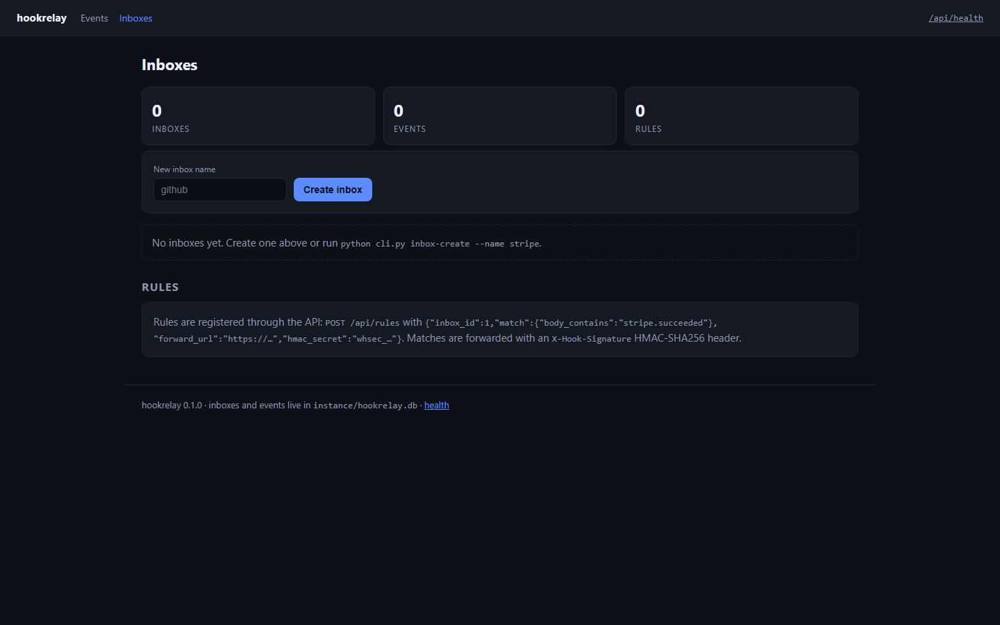
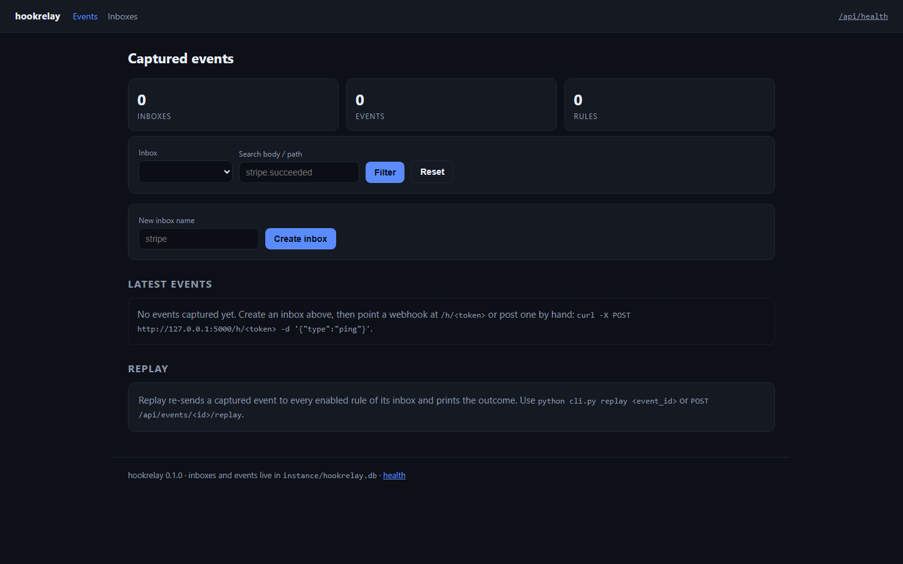
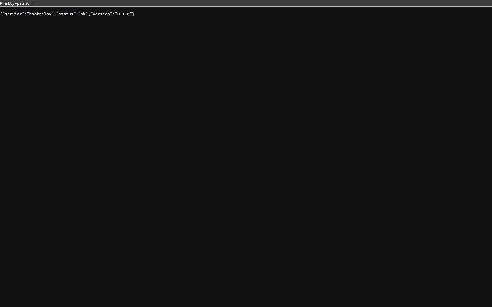
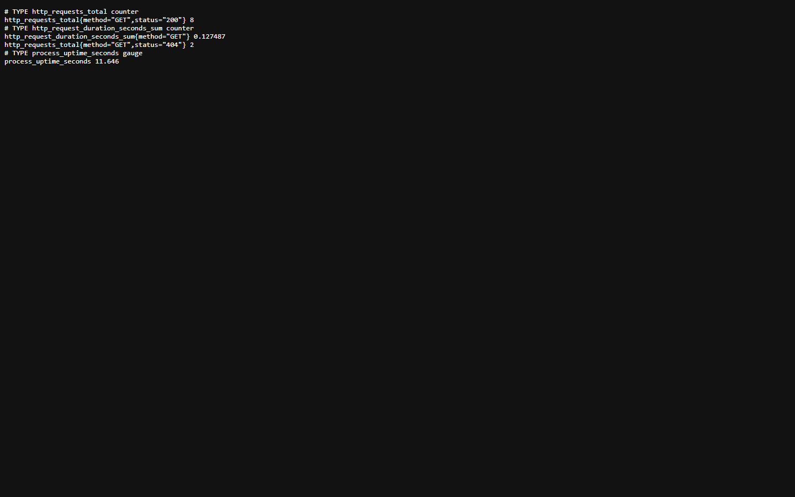
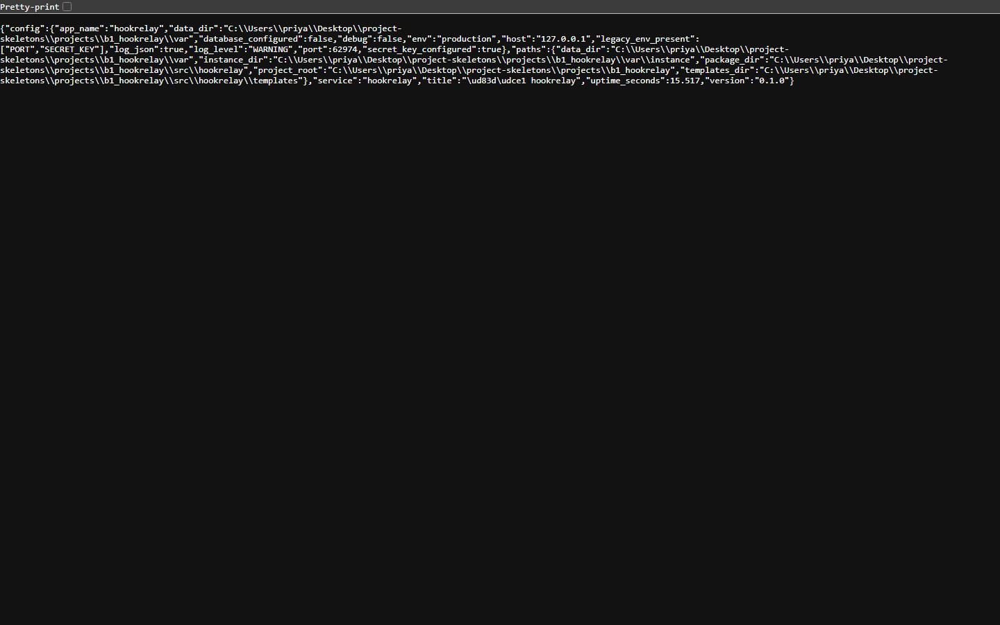

<p align="center">
  
</p>

<h1 align="center">hookforge</h1>

<p align="center"><b>Point any webhook at an inbox, read exactly what was sent, replay it.</b></p>

<p align="center">
  <a href="#quality-gates"></a> <a href="#quality-gates"></a> <a href="#api"></a> <a href="#requirements"></a> <a href="LICENSE"></a>
</p>

hookforge gives you a URL that accepts any method and any body, stores the request with its headers, and forwards it to the rules you attach. When a provider's payload shape surprises you, the captured request is right there — and replayable.

---

**Contents** &nbsp;·&nbsp; [Why](#why-this-exists) &nbsp;·&nbsp; [What it does](#what-it-does) &nbsp;·&nbsp; [Quickstart](#quickstart) &nbsp;·&nbsp; [API](#api) &nbsp;·&nbsp; [Screenshots](#screenshots) &nbsp;·&nbsp; [Measured](#measured-not-estimated) &nbsp;·&nbsp; [Architecture](#architecture) &nbsp;·&nbsp; [Quality gates](#quality-gates) &nbsp;·&nbsp; [Deploy](#deploy) &nbsp;·&nbsp; [Limits](#limits-stated-rather-than-hidden)

## Why this exists

Debugging a webhook from the sending side is guesswork: you cannot see the headers, the content type, or whether the body was form-encoded. Capturing first and forwarding second turns that into a row you can read and re-deliver.

## What it does

| Capability | How it works |
| --- | --- |
| **Any-method capture** | GET, POST, PUT, PATCH and DELETE all land in the same inbox with headers and body preserved. |
| **Forwarding rules** | Per-inbox rules with a target URL and optional header set; each delivery is recorded. |
| **Replay** | POST /api/events/<id>/replay re-delivers one captured event to its matching rules. |
| **Inbox dashboard** | An HTML page lists inboxes, events and rule counts so a new endpoint can be created in a browser. |

## Quickstart

```sh
git clone https://github.com/scar8969/hookforge.git
cd hookforge
python -m venv .venv && . .venv/bin/activate   # Windows: .venv\Scripts\activate
pip install -e ".[dev]"
python wsgi.py                                 # http://127.0.0.1:8000
```

The same work from the CLI:

```sh
python -m hookrelay.cli --help
```

Commands: `inbox-create`, `inboxes`, `events`, `replay`.

A first request:

```sh
curl -s http://127.0.0.1:8000/api/health | head
```

## Requirements

- Python **3.11+** — CI runs 3.11, 3.12 and 3.13.
- Runtime dependencies: `Flask>=3.0`, `Flask-SQLAlchemy>=3.1`, `SQLAlchemy>=2.0`, `PyYAML>=6.0`.
- No JavaScript build step: every page is server-rendered Jinja.

## API

Every route below is in [`openapi/hookforge.yaml`](openapi/hookforge.yaml) and is exercised by the live probe recorded in [`docs/EVIDENCE.md`](docs/EVIDENCE.md).

| Method | Path | What it does |
| --- | --- | --- |
| `GET` | `/api/health` | liveness probe |
| `GET` | `/api/inboxes` | list inboxes with their event and rule counts |
| `POST` | `/api/inboxes` | create an inbox |
| `GET` | `/api/events` | list captured events, newest first |
| `POST` | `/api/events/{id}/replay` | re-deliver one captured event to its matching rules |
| `POST` | `/api/rules` | add a forwarding rule to an inbox |
| `GET` | `/h/{token}` | capture a webhook request |
| `POST` | `/h/{token}` | capture a webhook request |
| `PUT` | `/h/{token}` | capture a webhook request |
| `PATCH` | `/h/{token}` | capture a webhook request |
| `DELETE` | `/h/{token}` | capture a webhook request |
| `GET` | `/inboxes` | HTML inbox dashboard |
| `POST` | `/inboxes/new` | create an inbox from the HTML form |
| `POST` | `/inboxes/{id}/delete` | delete an inbox from the HTML form |
| `POST` | `/events/{id}/delete` | delete a captured event from the HTML form |

## Screenshots

Captured from the running service with headless Chromium at 1440×900, one image per page, committed under [`docs/assets/screens/`](docs/assets/screens/).

<table>
<tr>
<td width="50%"><br><sub><code>/</code> &middot; 43.6 KB</sub></td>
<td width="50%"><br><sub><code>/healthz</code> &middot; 8.3 KB</sub></td>
</tr>
</table>

<table>
<tr>
<td width="50%"><br><sub><code>/livez</code> &middot; 7.3 KB</sub></td>
<td width="50%"><br><sub><code>/metrics</code> &middot; 14.8 KB</sub></td>
</tr>
</table>

<table>
<tr>
<td width="50%"><br><sub><code>/readyz</code> &middot; 7.7 KB</sub></td>
<td width="50%"><br><sub><code>/version</code> &middot; 26.3 KB</sub></td>
</tr>
</table>

## Measured, not estimated

These numbers were produced on this checkout by `pytest --cov` and by booting `wsgi.py` and issuing one real GET per documented path. The commands are in [`docs/EVIDENCE.md`](docs/EVIDENCE.md).

| Signal | Value |
| --- | --- |
| Tests | **25 / 25 passed** (3.5 s, exit 0) |
| Line coverage | **59.6%** — 454 of 712 statements |
| Source | 16 files / 1,562 lines |
| Test code | 4 files / 275 lines |
| Documented paths | 10 in the spec, 5 GET |
| Live probe | 11 GET requests to the booted app, **10 answered 200** |
| Median latency | **11.1 ms** (single uncached request, dev server) |
| Slowest / fastest | 74.3 ms `/` / 3.4 ms `/readyz` |
| Bytes served | 11.8 KB across 11 responses |
| Screenshots | 7 captured |

## Architecture

```
hookforge/
├── src/hookrelay/
│   ├── http.py                         379  HTTP plumbing for hookrelay: correlation ids, access
│   ├── config.py                       172  Environment-driven configuration for hookrelay
│   ├── observability.py                169  Structured logging and request correlation for hookr
│   ├── _app.py                         164  
│   ├── cli.py                          143  
│   ├── app.py                          119  Application factory for hookrelay
│   ├── relay/api.py                    114  
│   ├── errors.py                       108  Typed application errors and their HTTP mapping for 
│   ├── paths.py                         52  Filesystem layout for hookrelay
│   ├── relay/forward.py                 41  
│   ├── models.py                        38  
│   ├── relay/inbox.py                   24  
├── openapi/hookforge.yaml                 the contract of record
├── schema/hookforge.sql                   the DDL
├── tests/                       the suite that has to stay green
├── docs/EVIDENCE.md             the recorded live route walk
├── Dockerfile                   multi-stage build
└── wsgi.py                      entry point
```

The package keeps one shape across the service: `config.py` reads the environment once, `observability.py` emits structured JSON logs carrying a request id, `errors.py` turns exceptions into a single JSON envelope, `models.py` holds the tables, and the `relay/` package holds the routes.

## Quality gates

| Gate | Command | Threshold |
| --- | --- | --- |
| Suite | `pytest -q` | all green |
| Coverage | `pytest --cov` | floor set in `pyproject.toml` from the measured value |
| Lint | `ruff check src tests` | zero findings |
| Format | `ruff format --check src tests` | zero reformats |
| Types | `mypy src` | zero errors |
| Security | `bandit -c pyproject.toml -r src` | reviewed skip list, no unreviewed finding |
| Live routes | boot `wsgi.py`, one GET per documented path | no 5xx, no undocumented guard |

CI runs the first six on Python 3.11, 3.12 and 3.13 for every push to `main`, plus a container build. See [`.github/workflows/ci.yml`](.github/workflows/ci.yml).

## Deploy

```sh
docker build -t hookforge .
docker run --rm -p 8000:8000 --env-file .env.example hookforge
```

Configuration is environment-only — every variable is documented in [`.env.example`](.env.example), and the service refuses to start with a production secret missing.

## Limits, stated rather than hidden

- Capture bodies are stored in the database; very large payloads are truncated at the configured cap and the row says so.
- Forwarding is fire-and-forget per rule; there is no retry queue for a downstream that is down.

## License

MIT — see [LICENSE](LICENSE).
